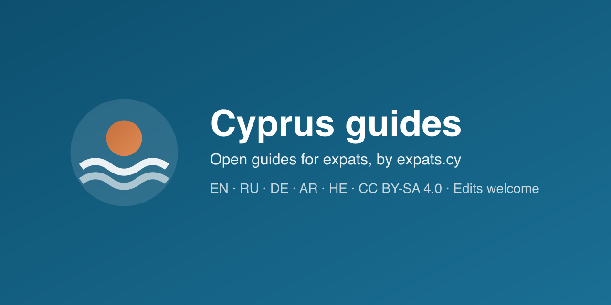

# Cyprus guides



Practical guides for expats in Cyprus — visas and residence, documents, taxes, property, business, everyday life — in English, Russian, German, Arabic and Hebrew. These are the editorial articles published on [expats.cy](https://expats.cy).

The text is open: anyone can fix a mistake, update an outdated fee or deadline, add a missing guide or translate one. Every change is reviewed by the expats.cy editor before it goes live.

## Fix or improve a guide

Every guide on expats.cy has an **Edit this page on GitHub** link at the bottom. It opens the file here in GitHub's editor; GitHub creates your copy and a pull request for you. No setup is needed beyond a free GitHub account.

What happens next:

1. Your pull request is checked by the expats.cy editor. Nothing goes live without that review.
2. If something needs changing, the editor comments on the pull request.
3. After it's merged, the change appears on expats.cy with the next site update, and the page's **History** link credits you.

## Add a language

- **Translations into English, Russian, German, Arabic or Hebrew** go live like any other change: copy the guide into `<language>/<section>/`, translate it, keep the same `translationKey`.
- **A new language** (for example Greek or Ukrainian) needs the site to support it as well. Open an issue or a pull request with translated guides in a new folder (`el/`, `uk/`, …); the language is switched on at expats.cy once there are enough guides for readers to find their way.

## For AI agents and tools

If you are an AI assistant or agent working on this repository, read [AGENTS.md](AGENTS.md) first. It lists the rules for sources, facts and file format. Pull requests written with AI help are welcome; say so in the pull request description.

## Layout

```
<language>/<section>/<article>.md
```

- Languages: `en`, `ru`, `de`, `ar`, `he`
- Sections: `immigration`, `documents`, `business`, `property`, `life`, `beyond-borders`, `videos`

Each file is Markdown with a YAML header (title, description, date, …). Versions of the same guide in different languages share a `translationKey`.

## Licence

The text in this repository is licensed under [Creative Commons Attribution-ShareAlike 4.0 International (CC BY-SA 4.0)](LICENSE). You may copy, adapt and republish it, also commercially, if you:

1. credit **expats.cy** and link to the original guide, and
2. publish your version under the same licence.

The licence covers the text in this repository only. The expats.cy name and logo, the site's design and code, images, videos and community articles written on the site by their authors are not included.

Copyright belongs to DailyMind LTD, the operator of expats.cy. Contributors sign the [Contributor License Agreement](CLA.md), which assigns copyright in their contributions to DailyMind LTD. The expats.cy name and logo are trademarks and are not licensed. Details: [NOTICE](NOTICE).

## Not legal or tax advice

Guides are general information, checked against official sources at the date shown on each article. Rules, fees and office hours change; confirm with the official source before acting.
